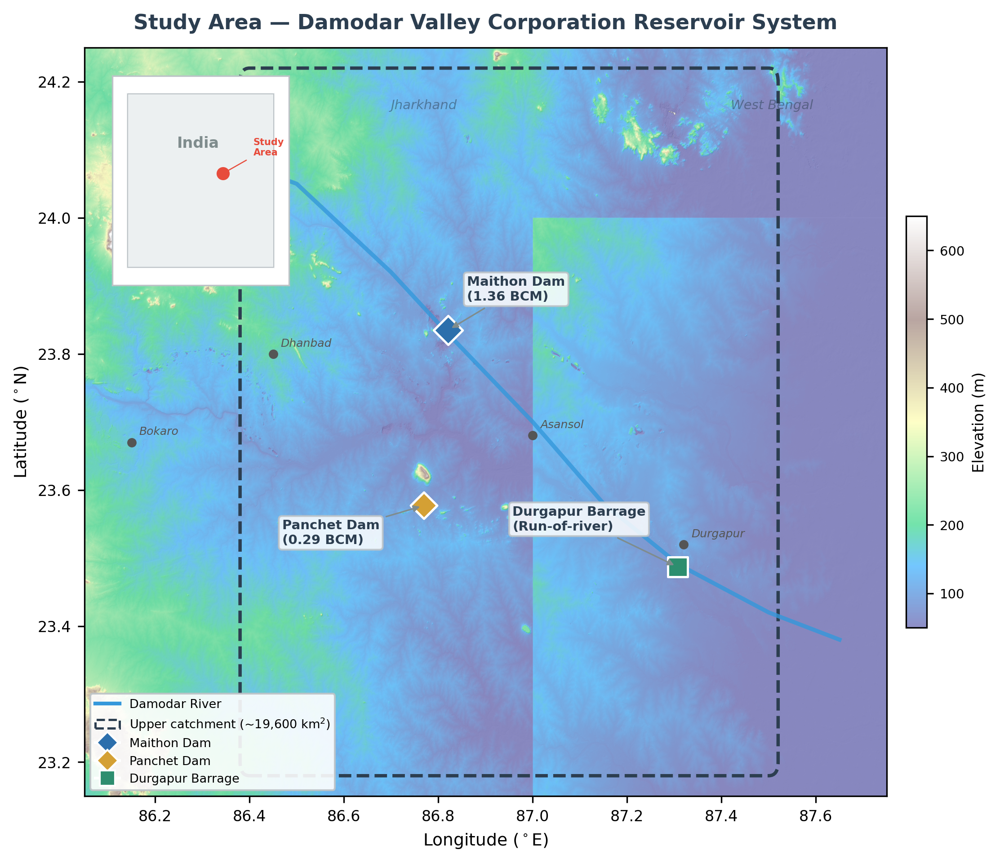
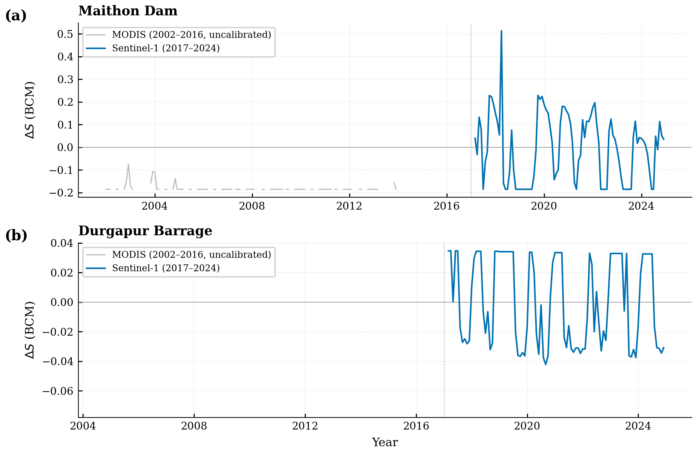
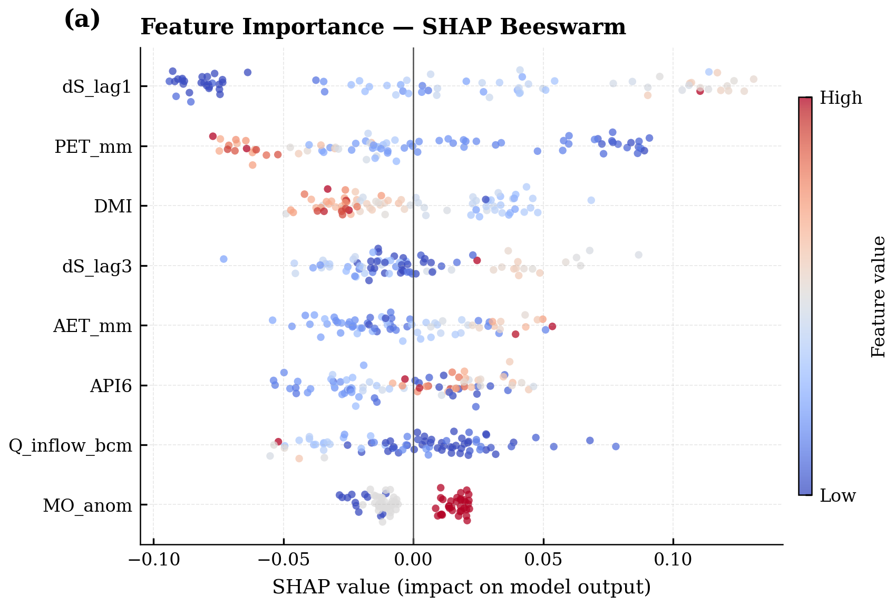
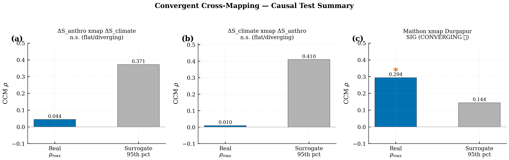
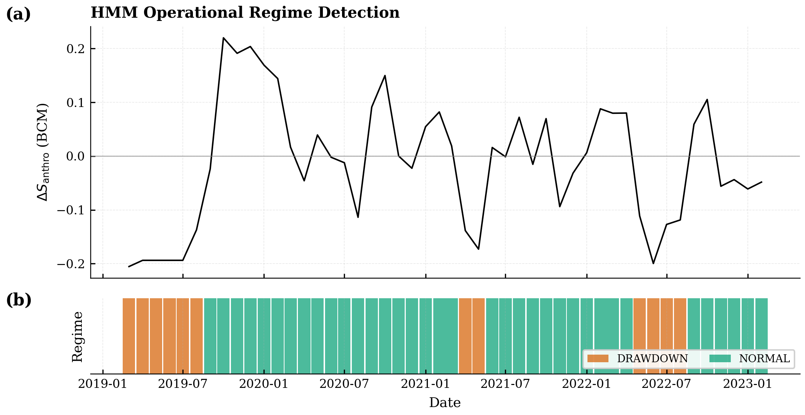
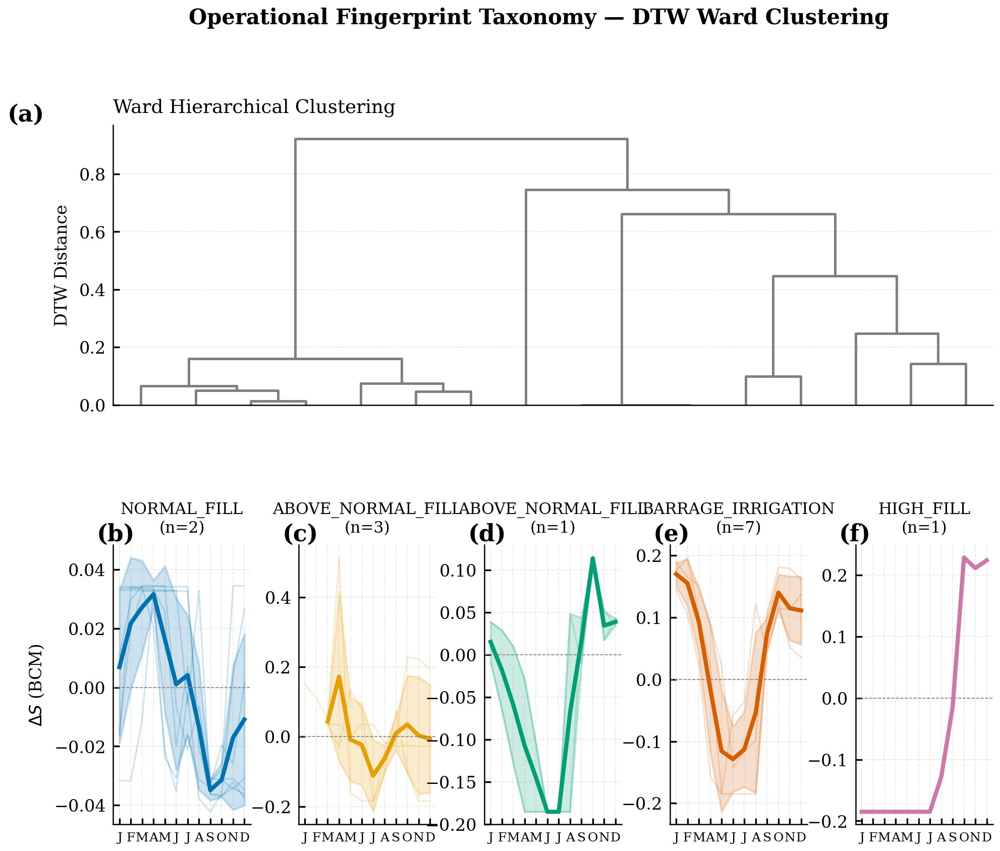
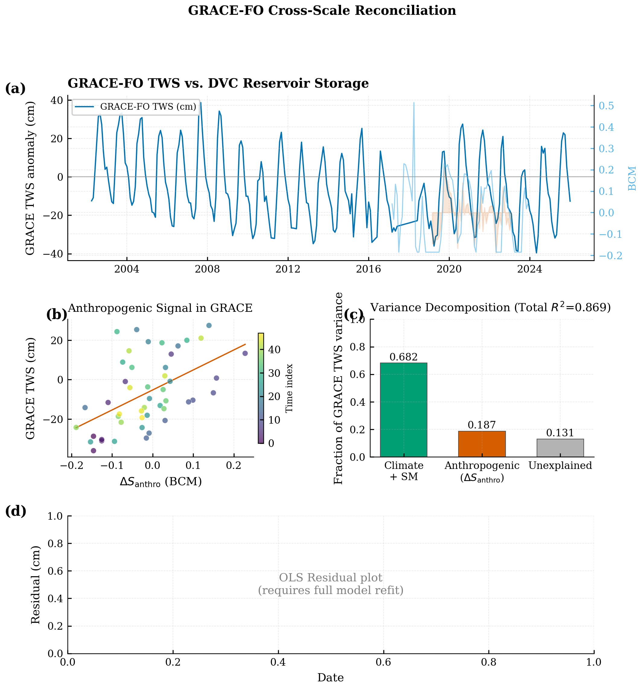
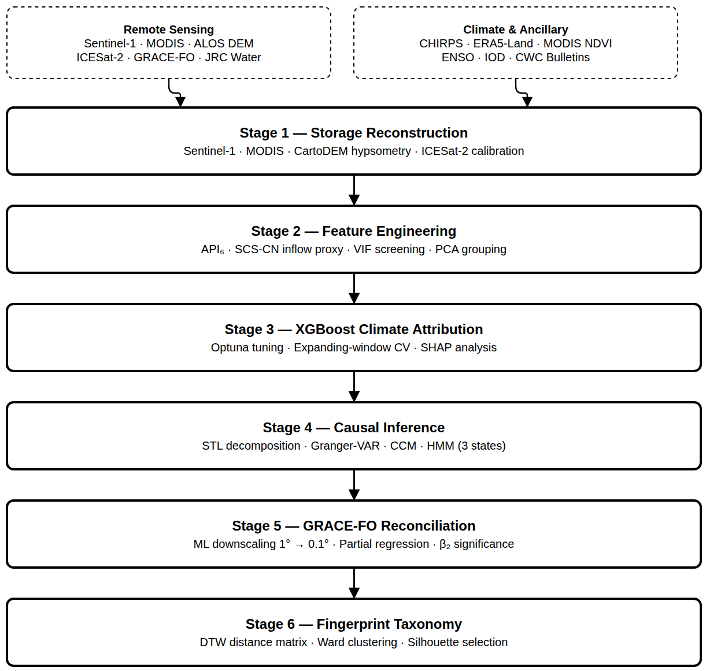

# Satellite-based attribution of anthropogenic storage signals in DVC reservoirs

Code and data pipeline for:

> Mandal, N.K. (2026). *Satellite-based attribution of anthropogenic storage signals in Damodar Valley Corporation reservoirs using explainable machine learning and causal inference.* B.Tech Project Report, Department of Civil Engineering, BIT Sindri.

Supervised by Dr. Maya Rajnarayan Ray, Associate Professor, Department of Civil Engineering, BIT Sindri.

## Overview

GRACE satellite data is increasingly used to monitor water stress across India's river basins. The problem is that GRACE cannot distinguish between climate-driven storage variability and storage changes caused by dam operations. In a managed basin like the Damodar, this distinction matters.

This study reconstructs monthly reservoir storage for three DVC reservoirs (Maithon, Panchet, Durgapur Barrage) from Sentinel-1 SAR and MODIS imagery over 2002--2024, then separates climate from anthropogenic signals using XGBoost attribution with SHAP, convergent cross-mapping, Granger causality, and Hidden Markov Models. A GRACE-FO reconciliation step confirms that the anthropogenic residual is detectable even at the coarse mascon scale.

All data sources are open-access and the entire pipeline runs at zero cost.



*Three DVC reservoirs in the Damodar basin, Jharkhand. Maithon (23.84N, 86.82E) and Panchet (23.58N, 86.77E) are storage reservoirs for flood control and hydropower. Durgapur (23.49N, 87.31E) is a run-of-river barrage feeding 2,494 km of irrigation canals.*


## Results

### Storage reconstruction and attribution

Sentinel-1 area-derived water levels match CWC/DVC measured levels to within RMSE = 0.07 m (n = 8, excluding one temporal mismatch point).

XGBoost trained on 8 climate features explains 57% of Maithon S1-era storage variance (NSE = 0.572). The remaining 43% is the anthropogenic residual. SHAP identifies prior-month storage anomaly, PET, and Indian Ocean Dipole as the three strongest predictors. Permutation importance confirms this ranking at p < 0.02 for each.

<p align="center">
  
</p>

<p align="center">
  
</p>


### Causal independence of the anthropogenic residual

CCM null checks confirm that the anthropogenic residual and the climate prediction are causally uncoupled (rho = 0.044, not significant against 999 phase-randomized surrogates). The XGBoost residual is not a modelling artifact.

CCM separately detects a significant Maithon-to-Durgapur link (rho = 0.294 vs. surrogate 95th = 0.144, converging), consistent with downstream hydraulic connectivity through the Damodar channel.

HMM partitions the anthropogenic signal into two operational regimes: DRAWDOWN (mean = -0.168 BCM, 25% of months) and NORMAL (mean = +0.033 BCM, 75% of months).

<p align="center">
  
  
</p>


### Operational fingerprint taxonomy

DTW clustering of annual storage cycles separates Durgapur barrage irrigation patterns from Maithon storage reservoir behavior with 100% accuracy (7/7 Durgapur years assigned to one cluster). Silhouette score = 0.49 at K = 3.

<p align="center">
  
</p>


### GRACE-FO reconciliation

Partial regression of GRACE-FO TWS anomaly on the anthropogenic residual, after controlling for climate, soil moisture, and PET:

- beta = +3.84 cm/BCM (HAC-corrected, Newey-West)
- 95% CI: [+2.13, +5.55] cm/BCM
- p < 0.001
- partial R-squared = 0.19

The fitted coefficient is within 10% of the theoretical value (4.28 cm/BCM for the 23,370 km-squared Damodar basin). The result holds after deseasonalization (p = 0.0003, partial R-squared = 0.20).

<p align="center">
  
</p>


### Methodology

<p align="center">
  
</p>


## Repository structure

```
.
|-- src/                              # Analysis pipeline (run in order)
|   |-- 01_storage_reconstruction.py
|   |-- 02_feature_engineering.py
|   |-- 03_xgboost_shap.py
|   |-- 04_causal_inference.py
|   |-- 05_grace_reconciliation.py
|   |-- 06_fingerprint_taxonomy.py
|   |-- 07_cwc_validation.py
|   `-- (auxiliary scripts)
|-- gee_scripts/                      # Google Earth Engine scripts
|   |-- s1_water_area.js              # Sentinel-1 water area extraction
|   |-- modis_water_area.js           # MODIS backfill 2002-2013
|   |-- driver_extraction.js          # CHIRPS, ERA5, NDVI, LULC, NTL
|   `-- av_hypsometry.js              # Area-volume curves from ALOS DEM
|-- notebooks/                        # Exploratory analysis
|-- data/
|   |-- raw/                          # GEE exports, CWC bulletins (gitignored)
|   `-- processed/                    # Pipeline outputs
|-- figures/                          # All figures (300 DPI, PDF + PNG)
|-- reports/                          # Thesis, manuscript, presentations, compiled PDFs
|   |-- main.tex                      # B.Tech thesis (LaTeX source)
|   |-- main.pdf                      # Compiled thesis
|   |-- references.bib                # Bibliography
|   |-- manuscript/                   # Journal paper draft (Elsevier format)
|   `-- presentations/                # Defense slides (Beamer + Overleaf export)
|-- journal/                          # Research log (findings, decisions)
`-- reservoir_watch/                  # Streamlit monitoring dashboard
```


## Reproducing the analysis

GEE scripts must be run first in [code.earthengine.google.com](https://code.earthengine.google.com) to generate the raw CSV exports. Place them in `data/raw/`. Climate indices (Nino 3.4, IOD/DMI) need to be downloaded from NOAA and JAMSTEC respectively.

Then run the pipeline:

```bash
pip install uv
uv sync

uv run python src/01_storage_reconstruction.py
uv run python src/02_feature_engineering.py
uv run python src/03_xgboost_shap.py
uv run python src/04_causal_inference.py
uv run python src/05_grace_reconciliation.py
uv run python src/06_fingerprint_taxonomy.py
uv run python src/07_cwc_validation.py
```

Full data source documentation is in Chapter 2 of the thesis (`reports/main.pdf`).


## Requirements

Python 3.11 or later, managed through [uv](https://docs.astral.sh/uv/). Main dependencies: xgboost, shap, statsmodels, hmmlearn, dtaidistance, pyEDM, scikit-learn, pandas, matplotlib.

A Google Earth Engine account is required for the GEE scripts.


## Citation

```bibtex
@bachelorsthesis{mandal2026dvc,
  author  = {Mandal, Nishi Kant},
  title   = {Satellite-Based Attribution of Anthropogenic Storage Signals
             in {Damodar Valley Corporation} Reservoirs Using Explainable
             Machine Learning and Causal Inference},
  school  = {{BIT} Sindri},
  year    = {2026},
  type    = {{B.Tech} Project Report},
  address = {Dhanbad, Jharkhand, India},
  note    = {Department of Civil Engineering.
             Supervised by Dr. Maya Rajnarayan Ray}
}
```


## Contact

Nishi Kant Mandal -- nishim.ce22.063@bitsindri.ac.in
Department of Civil Engineering, BIT Sindri, Dhanbad 828123


## License

Released for academic and research purposes. If you use this code or method, please cite the thesis above.
